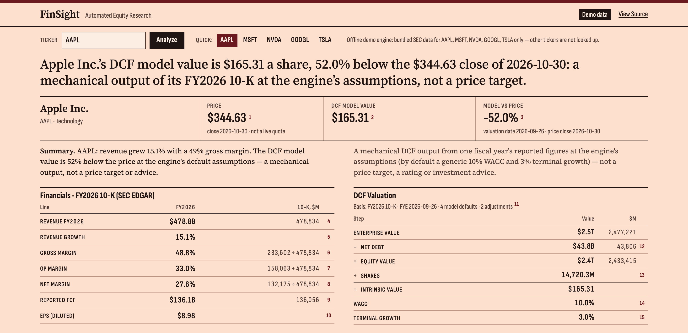

# FinSight

[](https://github.com/ROROK20/FinSight/actions/workflows/ci.yml)
[](https://python.org)
[](LICENSE)
[](https://fastapi.tiangolo.com)
[](CONTRIBUTING.md)

**FinSight reads a company's 10-K financials from SEC EDGAR, cites every figure to its filing, and builds a DCF and a research report from them.**

- **Every figure traces to the 10-K it came from.** One fiscal year at a time, never borrowed from another year, with the XBRL concept behind each figure named. Proof: `pytest tests/test_demo_data.py -k cited_10k`.
- **The valuation reproduces by hand, and refuses rather than guesses.** Apple's $165.31 matches an independent derivation to twelve digits, and a company missing a figure the model needs gets a refusal, not a placeholder. Proof: `pytest tests/test_demo_data.py -k independent_derivation`.

**Live demo:** https://finsight-kappa-five.vercel.app (a recording of the engine's answers for five tickers from bundled SEC filings).

**Run it:** `make demo` (needs Docker, no API keys), then open http://localhost:3002.

**Demo data, not advice.** The demo runs real SEC filings (retrieved 2026-11-04) beside a dated close (2026-10-30), not a live quote. Its sentiment panel scores a synthetic placeholder transcript and says so. The model value is the mechanical output of one year's figures at generic assumptions: not a price target and not financial advice.

<p align="center">
  
  <br>
  <em>Demo mode, AAPL, captured 2026-11-05 from the running stack. Every figure shown is what <code>/meta</code>, <code>/kpis</code> and <code>/dcf</code> return. Re-shoot it, and the social-preview card <code>frontend/public/og.png</code> (from the recording a frontend-only deploy shows), with <code>node e2e/capture.mjs</code>, which refuses to write an image whose figures differ from the API's.</em>
</p>

---

## Why trust the numbers

- **The data is SEC's, unmodified and pinned.** [`scripts/refresh_snapshots.py`](scripts/refresh_snapshots.py) cut the bundled files from a live fetch on 2026-11-04. `cd finsight/data/companyfacts && shasum -a 256 -c SHA256SUMS` checks their bytes, and [`tests/test_demo_data.py`](tests/test_demo_data.py) fails if one changes.
- **The engine is checked by arithmetic it did not write.** [`tests/hand_derivation.py`](tests/hand_derivation.py) writes the documented method out independently, for Apple, Microsoft and Alphabet: `pytest tests/ -k "independent_derivation or heavy_investors"`.
- **Live and demo give the same answer.** [Measured 2026-11-04](#refreshing-the-bundled-snapshots): the live SEC path equals the bundled values exactly for all five tickers. [`tests/test_live_path.py`](tests/test_live_path.py) holds the live endpoints to it offline.
- **The demo makes no network request.** [`tests/test_api.py`](tests/test_api.py) replaces every network method with one that raises or records: `pytest tests/test_api.py -k "offline or without_any_request"`.
- **The dashboard shows only the engine's figures.** `node e2e/smoke.mjs` drives a real browser against the real engine, and [`tests/test_recorded_demo.py`](tests/test_recorded_demo.py) fails if the recording drifts from it.

The limits are stated too, in every response and [below](#what-the-inputs-cannot-show): Tesla's $13.19, for one, is overstated by about 3%, and the response says so.

---

## Table of Contents

- [Why trust the numbers](#why-trust-the-numbers)
- [Live Demo — Run the Full Stack](#live-demo--run-the-full-stack)
- [What It Does](#what-it-does)
- [Features](#features)
- [Installation](#installation)
- [Quick Start](#quick-start)
- [Web Demo / Frontend](#web-demo--frontend)
- [SEC EDGAR Integration](#sec-edgar-integration)
- [DCF Model](#dcf-model)
- [Comparable Companies](#comparable-companies)
- [Sentiment Analysis](#sentiment-analysis)
- [REST API](#rest-api)
- [Testing](#testing)
- [Project Structure](#project-structure)
- [Documentation](#documentation)
- [Roadmap](#roadmap)
- [Contributing](#contributing)
- [Security](#security)
- [Code of Conduct](#code-of-conduct)
- [Changelog](#changelog)
- [License](#license)

---

## Live Demo — Run the Full Stack

Clone this repo and see the **real engine** driving the
dashboard in a browser with one command. No API keys. The first build needs a network to
fetch images, packages and fonts; once built, the demo makes no network request.

```bash
git clone https://github.com/ROROK20/FinSight.git
cd FinSight
make demo          # or: docker compose up --build
```

Then open **http://localhost:3002**. The frontend (Next.js, port 3002) calls
the **live FastAPI engine** (port 8001) for KPIs, the DCF valuation and a
sentiment score, which today is of the labelled placeholder transcript.

```
┌──────────────────────────┐        HTTP /meta /kpis /dcf /sentiment
│  Next.js dashboard :3002 │  ───────────────────────────────────────▶  ┌────────────────────────────┐
│  (frontend/app/page.tsx) │                                            │  FastAPI engine :8001       │
│                          │  ◀───────────────────────────────────────  │  finsight/api/app.py        │
│  lib/api.ts  ──► real    │        real-shaped JSON                     │   KPIExtractor → DCFModel   │
│  engine; with none, the  │                                            │   → SentimentAnalyzer       │
│  recording of it in      │                                            │   (SEC EDGAR XBRL, no keys) │
│  lib/recordedDemo.json   │                                            └────────────────────────────┘
└──────────────────────────┘
```

**Data modes** — a badge in the header tells you which is active:

| Mode | When | Source |
|------|------|--------|
| **Live data** | backend reachable, SEC EDGAR available | real SEC filings → real engine for the financials and DCF; sentiment reads "not available" unless `FINSIGHT_LIVE_TRANSCRIPTS=1`, and then comes from whatever transcript the source returned, today the labelled placeholder |
| **Demo data** | backend reachable, `FINSIGHT_DEMO=1` or SEC unreachable | bundled AAPL/MSFT/NVDA/GOOGL/TSLA data — real SEC EDGAR companyfacts snapshots (retrieved 2026-11-04) and 2026-10-30 closing prices — run through the **same** extraction and DCF code as the live path; sentiment from a synthetic placeholder transcript, tagged as such |
| **Partial data** | some engine calls failed | those panels read **Unavailable** and nothing replaces them; the rest come from the engine |
| **Not in demo set** | backend in demo mode, ticker outside the bundled five | nothing is looked up: a banner names the five covered tickers and how to run live, and no figure shows |
| **Engine recording · bundled SEC snapshots · no live backend** | no backend answered (e.g. a static deploy), ticker among the five | [`lib/recordedDemo.json`](frontend/lib/recordedDemo.json): the engine's own responses, recorded by [`scripts/record_demo.py`](scripts/record_demo.py); a test fails if they drift from the engine |
| **Offline · no data** | no backend answered, any other ticker | an empty state with the reason and no figure |

"Live data" needs **all four** calls (`/meta`, `/kpis`, `/dcf`, `/sentiment`)
to answer `mode: live`; a response with no `mode` counts as a failed call. The
sentiment panel is tagged **Synthetic** whenever it was computed from the
placeholder transcript, and the DCF panel shows its basis (fiscal year, 10-K)
and the number of model defaults it used. Where the engine's response carries a
source, the figure has a numbered footnote: the filing and XBRL concept for the
financials, the price's source, and the DCF's stated input sources.

**Every figure on the page is the engine's.** When a call answers,
every figure it carries is the engine's. A figure the engine does not report
(`null`, e.g. a bank's gross margin) reads **Not reported**, and the summary
leaves it out or says so. A call that failed reads **Unavailable**, and nothing
replaces it. *Model vs price* is shown only when both the price and the DCF value
came from the engine. While the calls are in flight the page shows "…", and a
slower response for a ticker you have already left is discarded. **A DCF the
engine refuses** (`422`, or `404` with its reason) is an answer, not a failed
call: the header block and the DCF panel show that reason and no number.

**A deploy with no backend replays a recording of the engine.**
[`lib/recordedDemo.json`](frontend/lib/recordedDemo.json) holds the engine's own
`/meta`, `/kpis`, `/dcf` and `/sentiment` responses for the five demo tickers, run
in-process with `FINSIGHT_DEMO=1`, and goes through the same merge as a running
engine's answers. `tests/test_recorded_demo.py` regenerates it and fails on any
drift. Any other ticker is an empty state with the reason and no figure. So `npm
run build` and a no-backend static deploy still never break.

**Peer multiples, multi-year history, catalysts and risks are not on the
dashboard.** The API serves one period per request and exposes no comps endpoint,
so the page names them as absent rather than invent them. Its two charts plot the DCF's
own projected revenue and modelled FCF, from `/dcf`: the model's output, not a
forecast and not reported history. The badge above describes the financials and
the DCF; the sentiment panel carries its own **Synthetic** tag.

### What "zero network" covers

With `FINSIGHT_DEMO=1`, **all six ticker endpoints** (`/meta`, `/filings`,
`/kpis`, `/dcf`, `/sentiment`, `/report`) serve bundled data for the five
demo tickers and make **no** SEC EDGAR, Yahoo Finance, or transcript request.
Every JSON response carries `"mode": "demo"`; `/report` returns Markdown, so it
carries a demo banner instead. Two endpoints answer by declining rather than by
inventing data:

- **`/filings`** returns an empty index plus a `detail` explaining why. Accession
  numbers and archive URLs are verifiable public records; this project does not
  ship invented ones. Unset `FINSIGHT_DEMO` to query real SEC EDGAR.
- **`/report`** omits its comparable-company section — peer multiples need live
  market data, and the alternative would be synthetic peers presented as real.
  The live report never invents them either: a peer (or the target) whose
  Yahoo data cannot be fetched, or holds no multiple, is left out and named, and with no peer data
  the section reads "Unavailable … (reason)" with no figure. So does a ticker with no curated peers: the peer groups are a
  hand-picked list for nine tickers, and the section says so.

The guarantee covers **every** ticker. Any ticker outside the bundled five is
refused with a `404` whose `detail` says demo mode is offline and how to run
live — it is never looked up, so typing `AMZN` into the `make demo` dashboard
makes no SEC, Yahoo or transcript request. The dashboard
shows a **Not in demo set** badge and banner instead of pretending to analyse
it. Without the flag, check a response's `mode` field rather than assuming
from the environment: a live failure can be answered from the bundled data.

### Run without Docker

```bash
make demo-local    # backend (FINSIGHT_DEMO) on :8001 + frontend dev on :3002
```

Or manually, in two terminals:

```bash
# terminal 1 — engine (demo/offline mode: no network or keys needed)
FINSIGHT_DEMO=1 uvicorn finsight.api.app:app --port 8001

# terminal 2 — dashboard
cd frontend && NEXT_PUBLIC_API_URL=http://localhost:8001 npm install && npm run dev
```

### Configuration

| Variable | Default | Purpose |
|----------|---------|---------|
| `NEXT_PUBLIC_API_URL` | `http://localhost:8001` under `next dev` only | where the frontend looks for the API. **Baked in at build time.** A production build without it has no engine: it replays the labelled recording of one and makes no request |
| `NEXT_PUBLIC_SITE_URL` | `http://localhost:3002` under `next dev` only | absolute base for share-card (Open Graph / Twitter) image URLs, baked in at build time; unset in production, no base is emitted rather than a localhost one |
| `FINSIGHT_DEMO` | unset | `1` = always serve bundled fixtures (offline); unset = live SEC EDGAR with demo fallback |
| `SEC_EDGAR_USER_AGENT` | unset — **required for live SEC requests** | your own name and a contact email that reaches you, sent as the User-Agent the SEC's [fair-access policy](https://www.sec.gov/os/accessing-edgar-data) requires. There is no fallback identity anywhere — not in the code, not in `docker-compose.yml` (which passes through only what you set). Unset, the documentation placeholder, a value without an email, or only undeliverable addresses (example.com/.net/.org, the .example/.invalid/.localhost/.test domains, no-reply) make live SEC requests fail with a `503` naming this variable. Not needed with `FINSIGHT_DEMO=1` |
| `FINSIGHT_LIVE_TRANSCRIPTS` | unset (off) | `1` = in live mode, scrape earnings-call transcripts from fool.com, a third party whose terms are yours to check. Off, no request is made and `/sentiment` and `/report` say "not available". Demo mode never scrapes |
| `OPENAI_API_KEY` | unset | optional — enables the LLM path of the `extract_from_text` library function (the API never calls it) |

See [`.env.example`](.env.example) for the full list. No secrets are committed.

### Deploy (do not auto-deploy)

The repo is deploy-ready for a split frontend/backend topology:

- **Frontend → Vercel.** [`frontend/vercel.json`](frontend/vercel.json) sets the
  Next.js build. Set `NEXT_PUBLIC_API_URL` in the Vercel project to your
  deployed API URL and `NEXT_PUBLIC_SITE_URL` to the deploy's public URL, then
  `vercel --prod` from `frontend/`. Without the first, the deploy replays the labelled
  recording of the engine for the five demo tickers and shows no figure for any other.
  Without the second, there is no share card: no Open Graph or Twitter image is emitted.
- **Backend → Render.** [`render.yaml`](render.yaml) is a Render blueprint that
  builds the root [`Dockerfile`](Dockerfile) and runs the API with
  `FINSIGHT_DEMO=1` (flip to `0` for the live SEC path). Any Docker host works —
  `docker build -t finsight-api . && docker run -p 8001:8001 finsight-api`.

---

## What It Does

```
Ticker Symbol
     │
     ▼
SEC EDGAR API ──────────────────────────────────────────────────┐
  10-K / 10-Q / 8-K                                             │
  XBRL Structured Data                                          │
     │                                                          │
     ▼                                                          │
KPI Extractor (XBRL)  ────────────────────────────────────────┐ │
  Revenue, Margins, EPS, FCF,                                   │ │
  Net Debt                                                      │ │
     │                                                          │ │
     ├──→ DCF Model ──→ Intrinsic Value                         │ │
     │                                                          │ │
     ├──→ Comps Analysis ──→ Multiple Benchmarking              │ │
     │       └── Peer EV/EBITDA, P/E, EV/Revenue               │ │
     │                                                          │ │
     └──→ Earnings Sentiment (word list + FinBERT)─────────────┘ │
              └── Net Sentiment, Guidance Tone, Drift            │
                                                                  │
     ▼                                                          ◄─┘
Research Report Generator
  ├── Markdown (human-readable)
  └── JSON (machine-readable)
```

Two parts of a report do **not** come from filings. Comparable-company multiples come from Yahoo Finance, in the live `/report` and the library only (the dashboard has no peer table). Sentiment is scored on **earnings-call text**: you can hand the library any transcript, but the only source the API has is a third-party web page that answered HTTP 404 when checked on 2026-11-01, so **today no API mode scores a real call: every `/sentiment` result, live and demo, is computed on a labelled synthetic placeholder.**

---

## Features

- **SEC EDGAR integration.** Fetches 10-K, 10-Q and 8-K filings via public SEC APIs (no key needed), and parses XBRL facts for precise financials without PDF parsing. See [SEC EDGAR Integration](#sec-edgar-integration).
- **Automated DCF valuation.** A 5-10 year FCF projection with a WACC sensitivity table. See [DCF Model](#dcf-model).
- **Comparable company analysis.** EV/Revenue, EV/EBITDA and P/E against a hand-picked peer group, from Yahoo Finance. See [Comparable Companies](#comparable-companies).
- **Financial sentiment analysis.** FinSight's own curated finance word list (161 tone and uncertainty words, inspired by the [Loughran-McDonald](https://sraf.nd.edu/loughranmcdonald-master-dictionary/) dictionary but not it) + optional FinBERT, and guidance tone from explicit guidance actions only. See [Sentiment Analysis](#sentiment-analysis).
- **Research report generation.** Markdown + JSON reports: cited financials, the DCF model value beside the price, sentiment and sources. No Buy/Hold/Sell rating or price target: the model value is a mechanical output of one year's figures at stated (by default generic) assumptions, labelled as such, not advice.
- **REST API.** FastAPI service: `/meta`, `/filings`, `/kpis`, `/dcf`, `/sentiment` and a Markdown `/report`. Comps run only inside the live `/report`; a standalone comps call, the DCF sensitivity table and the JSON report are library-only.
- **LLM KPI extraction (library, optional).** `KPIExtractor.extract_from_text` pulls KPIs out of unstructured filing text; the REST API and the dashboard use the structured XBRL path only. See [Text extraction](#text-extraction-library-optional).

---

## Installation

```bash
git clone https://github.com/ROROK20/FinSight.git
cd FinSight
pip install -e ".[dev]"        # dev extras include pytest — see Testing below

# Optional: LLM text extraction for KPIExtractor.extract_from_text (requires an OpenAI key)
pip install -e ".[llm]"

# Optional: FinBERT deep learning sentiment
pip install -e ".[finbert]"
```

`pip install -e .` resolves the version *floors* in `setup.py`, so a fresh
install may pick newer dependencies than the pinned set. That floor install is
what CI tests (`pip install -e ".[dev]"`, plus `beautifulsoup4`); CI does not
install either requirements file. For the pinned versions, which `pip-audit`
reports clean (see [SECURITY.md](SECURITY.md)), install from a requirements file
instead:

```bash
pip install -r requirements-api.txt   # the runtime, every package pinned
pip install -r requirements.txt       # those pins plus pytest, and also unpinned
                                      # openai, transformers and torch (large; the
                                      # test suite never exercises them)
```

**Configure environment variables** (copy the template and edit):

```bash
cp .env.example .env
# Required for live SEC requests — your own name and email, in this form:
#   SEC_EDGAR_USER_AGENT="Jane Doe jane.doe@example.org"   (example.org itself is refused)
# Optional for LLM extraction:    OPENAI_API_KEY=sk-...   (falls back to regex/XBRL)
```

The `finsight` console script loads `.env` itself; when running `uvicorn`
directly, pass `--env-file .env` (or export the variables).

> `.env` is git-ignored — never commit real secrets. See [`.env.example`](.env.example).

---

## Quick Start

```python
from finsight.ingestion.edgar import EdgarClient
from finsight.extraction.kpi_extractor import KPIExtractor
from finsight.models.dcf import DCFModel
from finsight.report.generator import ReportGenerator

# 1. Fetch XBRL financial data from SEC EDGAR (set SEC_EDGAR_USER_AGENT first).
#    Offline, use the SEC data bundled for demo mode instead:
#    from finsight.data import companyfacts_snapshot; facts = companyfacts_snapshot("AAPL")
client = EdgarClient()
cik = client.get_cik("AAPL")
facts = client.get_company_facts(cik)

# 2. One fiscal year's KPIs (the latest by default), each cited to its filing.
#    Output below is for SEC's data as of 2026-11-04; tests/test_docs.py runs
#    this block against the bundled snapshot of it.
kpis = KPIExtractor().extract_from_companyfacts(facts, "AAPL")
print(kpis.period, kpis.provenance["fiscal_year_end"], kpis.provenance["accession"])
# FY2026 2026-09-26 0000320193-26-000026
print(f"Revenue: ${kpis.revenue:,.0f}M, net margin {kpis.net_margin:.1%}")
# Revenue: $478,834M, net margin 27.6%

# 3. DCF valuation; every inferred input records where it came from, and every
#    departure from a reported figure is listed in assumptions.adjustments.
dcf = DCFModel().value_from_kpis(kpis)
print(f"Intrinsic value: ${dcf.intrinsic_value_per_share:.2f}/share, EV ${dcf.enterprise_value/1e3:,.1f}B")
# Intrinsic value: $165.31/share, EV $2,477.2B
print(dcf.assumptions.sources["ebitda_margin"])
# reported EBITDA / revenue, FY2026

# 4. Generate report
generator = ReportGenerator()
markdown = generator.to_markdown(generator.generate("AAPL", kpis=kpis, dcf_result=dcf))
```

---

## Web Demo / Frontend

An interactive dashboard built with **Next.js 15.5** on **React 19**
(TypeScript + Tailwind). It runs on port **3002** and is wired to the
**real FinSight engine**: headline financials and the DCF come from the live
FastAPI backend, and so does the sentiment score, computed today on the labelled
placeholder transcript. Every API call degrades gracefully: the API falls back to
bundled demo fixtures (still run through the real engine), and, if the backend is
entirely unreachable, the page replays a recording of the engine
(`lib/recordedDemo.json`) under a badge that says so, so `npm run build` and a
no-backend static deploy never break. A ticker the recording does not hold gets
an empty state with the reason and no figure.

**What is not live.** The sentiment panel is computed by the engine, but on
placeholder text until a transcript source answers, and is tagged **Synthetic**.
A peer table, multi-year history, catalysts and risks have no endpoint behind
them, so the page names them as absent rather than invent them.

```bash
cd frontend
npm install
npm run dev
# → open http://localhost:3002
```

Build a production bundle:

```bash
cd frontend
npm run build
```

---

## SEC EDGAR Integration

FinSight uses the SEC's **free, public APIs** — no API key required.

**What it covers.** Companies that file 10-Ks with SEC EDGAR and report the XBRL concepts
FinSight reads. A foreign filer on Form 20-F or 40-F has no 10-K facts, so `/kpis` and
`/dcf` answer `404` and say so. A company missing a concept the model needs gets a
refusal rather than a guess: a bank with no operating income gets its `/kpis` and a `422`
from `/dcf`. Checked on stubbed payloads, 2026-11-04.

```python
from finsight.ingestion.edgar import EdgarClient

client = EdgarClient()

# Look up CIK from ticker
cik = client.get_cik("MSFT")  # "0000789019"

# List recent 10-K filings
filings = client.get_filings(cik, form_type="10-K", limit=5)
for f in filings:
    print(f.period_of_report, f.filing_date, f.url)

# Download full filing text
text = client.get_filing_text(filings[0])

# XBRL structured data: one entry per fiscal year, in the concept's own unit
# (USD, shares, USD/shares). Filers differ — in SEC's live data Microsoft's
# `Revenues` stops in 2010, before the bundled snapshot's window (so the bundled
# MSFT file has none); it reports the ASC 606 concept since — which is why
# KPIExtractor reads ordered concept chains rather than one name.
facts = client.get_company_facts(cik)
revenue_series = client.extract_financial_series(
    facts, "RevenueFromContractWithCustomerExcludingAssessedTax")
# → [..., {'end': '2026-06-30', 'val': 331839000000, 'fy': 2026, 'form': '10-K', ...}]
#   (SEC data as of 2026-11-04)
```

### Text extraction (library, optional)

`KPIExtractor.extract_from_text` asks the LLM for 22 fields, coercing every answer to its type, with revenue guidance used by the DCF only when it is stated as full-year (GPT-4o-mini or any OpenAI-compatible endpoint; its accuracy is not measured here) from unstructured filing text, of which it reads only the first 8,000 characters (`max_text_chars`), so pass the section that holds the figures. Without a key it uses a regex fallback that reads only 6: revenue, net income, EBITDA and free cash flow (honouring K / M / B / T and the written-out units) plus gross and operating margin. That fallback is a pattern reader, not a parser: it takes a field's level from the label's own sentence, with its sign ("negative $1.2 billion", "-$3.0 billion", "($1.2 billion)", "a loss of", "net loss of"), and the level after "to" in "increased $5.1 billion to $94.9 billion". A sentence that states only a change, or leaves unclear what its figure belongs to, leaves the field empty. It still misreads a figure placed before the one it describes ("Net income excluding a $1 billion charge was $3 billion." reads 1,000), reads no figure with a year or other number between it and the label ("Revenue in 2025 was $94.9 billion." is empty), and reads no table without a dollar sign. Use XBRL for figures you will rely on. The REST API does not call it.

---

## Data sources & disclosure

FinSight ingests from the following sources. **You are responsible for
complying with each source's terms of use** for your deployment.

| Source | Used for | Mode | Notes |
|--------|----------|------|-------|
| **SEC EDGAR** (public API) | Filings, XBRL financials | live | Official, free, no key. Requires `SEC_EDGAR_USER_AGENT` (your name + email); requests are spaced process-wide under the SEC's 10 requests/second ceiling. |
| **Yahoo Finance** (`yfinance`) | Prices, company profile, peers' multiples | live | Unofficial third-party endpoint; subject to Yahoo's terms. It supplies each peer's figures, not the peer list, which is FinSight's own (`CURATED_PEERS`). A ticker's profile and split history are reused for at most 15 minutes (`TICKER_CACHE_TTL_SECONDS`). |
| **Motley Fool** (`fool.com` public pages) | Earnings-call transcripts | live, **off by default** | **Third-party web scrape — opt-in, and currently unavailable.** Nothing is requested unless `FINSIGHT_LIVE_TRANSCRIPTS=1`. Turned on: the listing page it reads (`/earnings/call-transcripts/?ticker=…`) answered **HTTP 404** when checked on 2026-11-01, so live sentiment currently always falls back to the labelled synthetic placeholder. Only links whose URL slug or title names the requested ticker are accepted, and only `https` links on fool.com itself are followed or fetched (an off-host link on the page is ignored). FinSight does not own or license this content and has not reviewed whether Motley Fool's terms allow this scrape: that question, and its robots policy, are yours to answer before you turn it on. The fetcher's User-Agent names the tool and carries no contact address; it spaces every request (one per second, shared process-wide) and remembers a miss for an hour rather than asking again. See [`finsight/ingestion/transcripts.py`](finsight/ingestion/transcripts.py). |
| **Bundled SEC snapshots** (`finsight/data/companyfacts/`) | KPIs, DCF | **demo** | Real SEC companyfacts for the five demo tickers, retrieved 2026-11-04 by [`scripts/refresh_snapshots.py`](scripts/refresh_snapshots.py) and trimmed to the 10-K facts for the 45 us-gaap concepts FinSight reads, for periods ending after a per-file date, about five fiscal years (values unmodified; each file's `_snapshot` states the window and lists the concepts). So a listed concept absent from a file has no 10-K fact *in its window*; the filer may have reported it earlier. [`SHA256SUMS`](finsight/data/companyfacts/SHA256SUMS) pins the files, and a test fails if one changes. Every concept the extractor reads is carried (`_snapshot.not_carried` is empty), and every demo response cites the fiscal year and 10-K accession. Offline, no network. |
| **Bundled prices** (`finsight/api/demo_data.py`) | Demo current price | **demo** | Yahoo Finance daily close, 2026-10-30 — dated in `/meta` and the report, never presented as a live quote. It predates the snapshots and Apple's FY2026 10-K (filed 2026-11-03). |

**Demo / offline mode makes no third-party requests.** With `FINSIGHT_DEMO=1`,
the API serves bundled fixtures and builds sentiment from a synthetic mock
transcript (`TranscriptFetcher.create_mock_transcript`) — it never scrapes
`fool.com` or calls Yahoo/SEC. **Live mode does not scrape either unless you opt in:**
without `FINSIGHT_LIVE_TRANSCRIPTS=1`, `/sentiment` answers `available: false`, no
results and why, and `/report` says "Not available" in its sentiment section. Opted in,
the scrape degrades to the same placeholder on any failure, so a run never hard-fails
on an unreachable source.
**A placeholder is always labelled:** every `/sentiment` result carries
`synthetic` (and `source`: the transcript URL, or a note that it is the
placeholder), the response's top-level `synthetic` is true if any result is,
`/report` prints a "Synthetic transcript" warning in its sentiment section, and
the dashboard tags the sentiment panel. The placeholder is the same boilerplate
for every company, so its scores are identical across tickers. **Live
transcript scraping depends on a third-party page that may be unavailable** —
it was (HTTP 404) when checked on 2026-11-01 — and an unavailable page means
the labelled placeholder, never someone else's transcript: a link is used
only if its URL slug or title names the requested ticker. The links to real
transcripts that are found (ticker, quarter, URL) are cached for 24 hours under
`~/.finsight/transcripts/`, not their text, which is fetched again each time (see
[SECURITY.md](SECURITY.md)). Whether the Motley Fool's terms allow this is an open
question FinSight has not answered, which is why it is off by default.

### Refreshing the bundled snapshots

The maintainer's step, not a user's: a live SEC fetch under your own name and email.

```bash
SEC_EDGAR_USER_AGENT="Your Name you@yourdomain" python scripts/refresh_snapshots.py
```

Put your own name and email in it; it refuses to run without a deliverable identity,
that placeholder included. For each of the five files it fetches SEC's
companyfacts, keeps the 10-K facts for the concepts FinSight reads for periods ending
after the date the file already states, writes the JSON and `SHA256SUMS`, and prints what
moved, fact by fact and in each filer's total debt and DCF value. Nothing is written until
all five are fetched, and `--directory` writes the cut elsewhere to review it first.
`tests/test_refresh_snapshots.py` exercises the cut offline on stubbed payloads built from
the bundled files.

**The live path, proved 2026-11-04.** The bundled files are this script's output from a live
run that day. Then the API ran in-process with `FINSIGHT_DEMO` unset and the maintainer's
`SEC_EDGAR_USER_AGENT`: `/kpis` and `/dcf` for all five tickers answered 200 with `mode` live and
no `fallback_reason`, and the reported KPIs, every DCF assumption and the value per share equal
the bundled ones exactly: AAPL $165.31 (FY2026, accession 0000320193-26-000026), MSFT $313.23,
NVDA $127.44, GOOGL $142.65, TSLA $13.19. Neither call asks Yahoo. `tests/hand_derivation.py`
re-derives the Apple and Microsoft values independently of the engine.

What must be re-derived afterwards, which the script also prints:

1. `SNAPSHOT_RETRIEVED` in `finsight/data/__init__.py`, and an empty `KNOWN_SNAPSHOT_GAPS`.
2. The recording: `python scripts/record_demo.py`.
3. The documented values, wherever a test names them: this README,
   `tests/test_recorded_demo.py`, `tests/test_dcf.py`, `tests/test_demo_data.py`,
   `tests/hand_derivation.py`, `e2e/smoke.mjs`.
4. `KNOWN_CURRENT_DEBT` in `finsight/api/demo_data.py` cites Tesla's latest 10-K: update its
   figures. If Tesla's total debt now holds its current debt, it, the Tesla note below and its
   tests go.
5. The two images: `node e2e/capture.mjs`.

---

## DCF Model

```python
from finsight.models.dcf import DCFModel, DCFAssumptions

# Full control over assumptions
assumptions = DCFAssumptions(
    base_revenue=394_000,        # $394B baseline revenue
    revenue_growth_rates=[0.08, 0.07, 0.06, 0.05, 0.05],
    terminal_growth_rate=0.03,
    ebitda_margin=0.32,
    wacc=0.09,
    net_debt=33_000,             # debt - cash, $M
    shares_outstanding=15_500,   # diluted shares, millions
)

model = DCFModel(n_years=5)
result = model.run(assumptions)

# tests/test_docs.py executes this block and
# fails if the printed output stops matching.
print(result)
# DCFResult(intrinsic=$104.68, EV=$1655.5B, TV%=76.3%)

# Sensitivity analysis
print(result.sensitivity_table)
#             TGR=2.0%  TGR=3.0%  TGR=4.0%  TGR=5.0%
# WACC=7.0%     130.94    158.70    204.96    297.49
# WACC=8.0%     108.47    126.28    153.00    197.54
# WACC=9.0%      92.42    104.68    121.83    147.57
# WACC=10.0%     80.40     89.25    101.06    117.59
# WACC=11.0%     71.05     77.69     86.22     97.60
```

How the model computes it:

- **Free cash flow** each year is EBIT × (1 − tax) + D&A − CapEx − ΔNWC, with
  **ΔNWC = `nwc_pct_of_revenue_change` × (revenue − prior-year revenue)** —
  working capital held at a constant share of revenue, invested as revenue
  grows and released as it shrinks.
- **Two free cash flows, two names.** The FCF above is the model's. It
  starts from operating income, which is after stock-based compensation, and never
  adds that back, so stock comp stays a cost. It also charges a flat 21% tax on EBIT
  and working capital at 2% of the revenue change, and leaves out interest and other
  non-operating income. **Reported FCF** (`/kpis` `free_cash_flow`, the dashboard's
  *Reported FCF* row) is operating cash flow − CapEx: the cash-flow statement adds
  stock comp back as non-cash and holds the taxes actually paid, interest and the
  actual working-capital movement. So the two differ, in either direction. On the
  bundled snapshots, 2026-11-04:

  | Ticker | Reported FCF | The model's formula on that year's figures, before growth and ΔNWC | DCF Year 1 |
  |--------|--------------|-------------------------------------------------------------------|------------|
  | AAPL | $136,056M | $129,252M | $147,275M |
  | MSFT | $66,987M | $45,689M | $52,636M |
  | NVDA | $96,676M | $96,910M | $133,946M |
  | GOOGL | $73,266M | $31,630M | $35,187M |
  | TSLA | $6,220M | −$57M | $0.7M |

  Year 1 also moves growth and CapEx along their fades. FinSight does not read a
  stock-compensation concept and the snapshots carry none, so this data cannot say how
  much of a gap is stock comp. `/dcf` `limitations.free_cash_flow_basis`, `/report` and
  the dashboard state each ticker's own figures.
- **Terminal value** is Gordon growth on a normalised year *n*+1 whose revenue
  grows at the terminal rate, so the perpetuity's working-capital charge
  reflects terminal growth rather than the final explicit year's.
- **WACC must exceed terminal growth by at least 2 percentage points**
  (`DCFModel.MIN_WACC_SPREAD`): the terminal multiple is 1 / (WACC − g), which
  is undefined at zero and meaningless near it. `run()` raises `ValueError`
  below that spread, sensitivity cells inside it are blank (`NaN`), and the
  `/dcf` endpoint answers 422.
- **Sensitivity cells are the endpoint's own results.** For a valuation
  built by `value_from_kpis()`, each cell re-fades year-1 growth to *that
  cell's* terminal rate, so the AAPL WACC 10% / TGR 4% cell is $191.01,
  exactly `/dcf/AAPL?terminal_growth=0.04`. Hand-built assumptions,
  like the example above, keep their own growth rates.
- **The horizon is `n_years`, and the inputs must cover it.** `run()` refuses
  (`ValueError`) assumptions with fewer revenue growth rates than `n_years`,
  and a share count that is not positive. `value_from_kpis()` always
  builds one rate per year, so `/dcf?n_years=10` projects ten.
- **`value_from_kpis()`** infers every assumption it can from reported
  figures, refuses (`DCFInputError`) when revenue, diluted shares or any
  margin input (operating income or EBITDA) is missing instead of
  substituting placeholders, and records where each input
  came from in `assumptions.sources` — anything not reported is marked
  `default: …` (including WACC and terminal growth when the caller does not
  pass them). The defaults that are **company figures** rather than tunable
  model parameters (D&A, CapEx, net debt, year-1 growth) are listed as
  `assumed_fundamentals` in `/dcf`. They are named next to the value in the
  report's opening note and in the dashboard's DCF panel. None of the five
  demo tickers has any. Every input the projection moves away from its reported
  starting point is described in `assumptions.adjustments` (the `/dcf`
  response's `adjustments`; the report's Data Sources; the dashboard's
  adjustment count):
  - **Revenue growth**: year 1 at trailing YoY (clamped to −30%…+40%), moving
    linearly to the terminal rate by year *n*, so a shrinking company is
    modelled as shrinking.
  - **CapEx**: year 1 at the **reported** CapEx / revenue, moving in equal
    steps to the *steady-state reinvestment rate* by year *n*, which the
    terminal year keeps (a perpetuity cannot out-invest depreciation
    forever). A company investing heavily today is charged for it in the
    years it spends, not assumed to stop at once. Unreported CapEx is a
    default at that rate. The steady state is **D&A less amortization of
    acquired intangibles** where the filer reports it
    (`AmortizationOfIntangibleAssets`). That amortization is non-cash and is
    added back, but CapEx does not replace it: replacing it would mean new
    acquisitions, which are outside the model. Where only a combined D&A is
    reported, the steady state is the combined rate. That is conservative:
    any acquisition amortization inside it lowers the value. `/dcf`
    `limitations` says which rule applied. A Broadcom-like acquirer (CapEx 1.1% of
    revenue, D&A 20.4%, nearly all of it acquisition amortization) is valued at
    $64.48 a share this way, and at $39.82 if CapEx faded to total D&A (the test
    fixture). On the bundled latest years AAPL, MSFT and NVDA report the concept:
    Apple's steady state is 1.8% of revenue against its 2.8% D&A rate, Microsoft's
    10.3% against 11.8%, NVIDIA's 1.1% against 1.3%. GOOGL and TSLA report none for
    their latest year, so theirs is the D&A rate. On Apple's FY2026 figures this rule
    is worth $5.50 of the $165.31: the value would be $159.81 with CapEx fading to
    total D&A. The concept's label says amortization of intangible assets, and FinSight
    treats all of it as acquired, which the XBRL fact alone cannot confirm.
  - **Operating loss, or a non-positive equity or enterprise value**: the model
    **refuses** ("not meaningful"; `/dcf` 422) when operating income (EBIT) is zero or
    negative, or the resulting equity or enterprise value is. Tax is never negative, so
    no loss earns a perpetual tax credit, and net cash cannot carry a negative enterprise
    value to a positive per-share value.
  - **EBITDA margin**: held at the reported margin, capped at 60%. Below
    5%, or negative, the model **refuses** (`DCFInputError`; `/dcf` answers
    422 and the report omits the DCF). It holds the margin flat into
    perpetuity, so a loss-maker has no meaningful value here.
  - **Net debt**: an unreported side (debt or cash) counts as zero.

  *Definitions behind the per-share value* (stated in every `/dcf`
  `assumption_sources`):
  - **Net debt** = total debt (`LongTermDebt`, or its current + noncurrent
    parts, plus `CommercialPaper` / `ShortTermBorrowings`) − cash and cash
    equivalents (`CashAndCashEquivalentsAtCarryingValue`). `LongTermDebt` usually
    holds the current part, but not for every filer, so current debt
    (`LongTermDebtCurrent`, `DebtCurrent`, or the balance-sheet
    `LongTermDebtAndCapitalLeaseObligationsCurrent` less its finance leases) is
    added only on evidence: `LongTermDebt` equals `LongTermDebtNoncurrent`, or only
    `LongTermDebt` + current meets the balance sheet's debt. Otherwise it is not
    added, so nothing is counted twice, and `limitations.current_debt` says what is
    unsettled. A filer with neither `LongTermDebt` nor
    `LongTermDebtNoncurrent` is read from the wider tags, a total concept winning over its
    components so nothing counts twice: the balance sheet's
    `LongTermDebtAndCapitalLeaseObligations` lines (less `FinanceLeaseLiability…` where tagged,
    else `limitations.long_term_debt_leases` says the leases are in), then `NotesPayable` (or
    `LongTermNotesPayable`), then `SeniorNotes` and `ConvertibleNotesPayable` added together,
    each with its noncurrent and current forms. **The chain is a list of common tags, not every
    tag, so a filer using other tags can read low.** Every `/dcf` names what it used in
    `total_debt_concepts`. Short-term debt with no long-term concept at all reads
    `limitations.long_term_debt_not_found`, and a figure reported above the total, which the
    total cannot be holding, reads `limitations.debt_above_total` and is not added. With no debt figure at all, debt counts as 0 and is flagged
    as an assumed figure beside the value in `/dcf` (`assumed_fundamentals`), `/report`
    and the dashboard, since debt under any other tag overstates the value by all of it.
    Current and
    non-current marketable securities are **not** netted, so for cash-rich filers net debt is
    overstated and the per-share value understated — conservatively. The snapshots carry
    no securities concept, so how much each filer holds is not stated here, but what a
    holding would move is arithmetic: each $1B not netted is $0.28 a share for Tesla
    (2.1% of its $13.19), the most of the five, against $0.07 a share for Apple (0.04% of
    its $165.31). `/dcf` `limitations`, `/report` and the dashboard say so too, and the report and the dashboard print net debt, equity value and
    shares beside enterprise value. Going from enterprise value to equity value also ignores
    noncontrolling (minority) interests and preferred stock. For a filer that
    has either, equity value and the per-share value are *overstated* by that
    amount (stated in every `/dcf` `assumption_sources`). Netting them means reading
    the securities concepts, in the extractor and the bundled snapshots alike, so demo and
    live keep one definition.
  - **Stock splits (live).** The share count is as its 10-K reported it, but
    Yahoo's prices are split-adjusted. When Yahoo reports a split after the
    share count's filing date (`provenance.per_share_filed`), the report and
    the dashboard **withhold model vs price** and say why. A 10:1 split
    would otherwise read as a ~−90% gap. When Yahoo does not answer for the split
    history, a split cannot be ruled out, and both withhold it too. The demo does not run
    this check: it bundles no split history, so it sets each 10-K's share count beside
    the 2026-10-30 close as they stand, across the gap the next point states.
  - **Valuation date vs price date.** The value is struck at the base 10-K's
    fiscal year-end — year-1 cash flow is discounted one year from it and net
    debt is as of it — and is **not rolled forward** to the date of the price
    it is set beside. In the demo the two sit apart: every price is the 2026-10-30 close,
    34 days after AAPL's valuation date (2026-09-26) and 303 days after GOOGL's and
    TSLA's (2025-12-31), by which time part of "year 1" has already happened. `/dcf` returns the
    `valuation_date`, and the report and the dashboard print both dates next
    to the model-vs-price comparison.
  - **Shares** = the fiscal year's diluted **weighted-average** count
    (`WeightedAverageNumberOfDilutedSharesOutstanding`), not the year-end
    count. It includes dilution but lags buybacks and issuance: on the
    bundled snapshots (2026-11-04) Apple's FY2026 figure is 14,720.3M against
    14,532.3M basic shares at year-end, Tesla's FY2025 3,528M against 3,751M. Where
    no diluted count is reported the period-end basic count is used and the
    source says so. Where the year-end count in the same 10-K is above the
    diluted count, `/dcf` `limitations.share_count` says what it would move
    (Tesla, below).

  *What the CapEx method does and does not settle.* The steady state uses
  today's D&A rate; for a company whose CapEx runs far above D&A, D&A will
  itself rise as that investment depreciates, so the terminal year — about
  80% of enterprise value for the heavy investors — is generous. Measured on
  the bundled snapshots, 2026-11-04, at the default 10% WACC / 3% terminal
  growth: MSFT (FY2026 CapEx 34.9% of revenue vs a 10.3% steady state) is **$313.23**
  a share with the fade, $343.16 with CapEx at the steady state from year 1, and $120.93 if
  reported CapEx were held flat in perpetuity; GOOGL (22.7% vs 5.2%)
  **$142.65**, $157.77 and $47.54. The fade fixes the explicit years; the
  terminal assumption is the lever that remains, and it is yours to vary
  via `DCFAssumptions.terminal_capex_as_pct_revenue`.

  <a id="what-the-inputs-cannot-show"></a>*What the inputs cannot show* (`/dcf` `limitations`,
  the report's Data Sources; the dashboard's *What the DCF's inputs cannot show* panel).
  Disclosed, not corrected for:
  - **Tesla: the demo's debt excludes current debt.** Total debt is Tesla's `LongTermDebt` tag,
    the noncurrent part. Its
    [FY2025 10-K](https://www.sec.gov/Archives/edgar/data/1318605/000162828026003952/tsla-20251231.htm)
    shows $1,569M of current debt beside $6,584M long-term at 2025-12-31: the balance sheet's
    debt and finance leases are $1,640M current and $6,736M noncurrent, less the $71M and
    $152M of finance leases. So the documented **$13.19 is overstated**: at that $1,569M, by
    about $0.44 a share, about 3% of the $13.19. The snapshot carries `DebtCurrent`, but the
    two sheet lines are `tsla:` extension tags, which SEC's companyfacts us-gaap facts do not
    hold, and Tesla reports no `LongTermDebtNoncurrent`. So the extractor's evidence rule
    (see *Net debt* above) cannot settle it and adds nothing; on the live path
    `limitations.current_debt` says only that it is unsettled. A later 10-K under tags the
    extractor reads would settle it, whereupon `/dcf`, `/report`, the dashboard and the
    recording stop saying this. Facts are never edited by hand.
  - **Tesla: the year-end share count is above the "diluted" one.** The
    value divides by the 3,528M diluted weighted-average count for FY2025, below the
    3,751M shares outstanding at that fiscal year-end in the same 10-K. On 3,751M, the
    $13.19 value would be $12.41: $0.78, or 5.9%, lower, more than the current debt
    above. The value stays on the diluted count, the rule for every filer, and FinSight
    does not say which count is right. Of the five latest demo years, only Tesla's
    has this.
  - **Tesla: marketable securities are not netted.** Net debt nets cash and cash
    equivalents only, and the bundled snapshot holds no securities concept, so what Tesla
    holds is not in the data and no dollar figure is given here. What it moves is
    arithmetic: each $1B not netted is $0.28 a share, 2.1% of the $13.19. It runs the other
    way from the two above: a holding not netted understates the value. A refresh would
    need the securities concepts read as well.
  - **A stale base year** (`limitations.stale_valuation`, the report beside its dates).
    "Latest" is the latest year with annual revenue in the filer's 10-K facts, so a filer
    whose revenue tags stopped in 2014 is valued as of 2014. When the valuation date is
    more than 548 days (about 18 months: a latest 10-K normally lags at most about 15) before the price
    date, the response says so; `/dcf` has no price on the live path and uses the day of the request. The
    value does not change. None of the five bundled latest years trips it: the
    oldest, Alphabet's and Tesla's, are 303 days before the demo's price.
  - **D&A is depreciation only for GOOGL and TSLA.** D&A comes from the filer's total concept
    (`DepreciationDepletionAndAmortization`, `DepreciationAndAmortization` or
    `DepreciationAmortizationAndAccretionNet`), else `Depreciation` +
    `AmortizationOfIntangibleAssets`, else `Depreciation` alone. AAPL and NVDA report a total;
    MSFT is the sum ($34,300M + $4,700M for FY2026). GOOGL and TSLA report neither a total nor
    the amortization for their latest year, so their D&A, EBITDA and the D&A add-back are
    property-and-equipment depreciation only, and understated by any amortization, as is
    year-1 FCF (EBIT × (1 − t) + D&A − CapEx). Their steady-state CapEx, by contrast, should be
    PP&E depreciation (see CapEx above), so it is already like-for-like. The `/dcf`
    `limitations` say so, and `tests/test_demo_data.py` fails if the extractor ever reads a
    concept that a snapshot neither carries nor declares as a gap.
  - **Finance leases** (material for MSFT): CapEx is
    `PaymentsToAcquirePropertyPlantAndEquipment`, so assets obtained under
    finance leases are not in CapEx, and finance-lease liabilities are not in
    total debt.

---

## Comparable Companies

Benchmarks EV/Revenue, EV/EBITDA, P/E against a peer group FinSight hand-picked for nine tickers (AAPL, AMZN, GOOGL, JNJ, JPM, META, MSFT, NVDA, TSLA) and looks up for no other: for any other ticker the report's comps section reads "Unavailable" and says this. A loss-making peer's negative (or zero / non-finite) multiple is left out of the peer statistics and named in the report, never averaged in, a peer priced in one currency and reporting in another (TSM, NIO and LI trade in USD and report in TWD or CNY) is left out and named, since no exchange rate is applied, and a financial company (Yahoo's "Financial Services" sector: JPM of the nine) gets no implied enterprise value, with the reason stated, since its deposits and borrowings are what it works with rather than financing to net off; its price multiples still apply.

---

## Sentiment Analysis

**Where the text comes from.** Earnings-call transcripts, never SEC filings. The
library scores any text or transcript you give it. The API's only transcript
source is the third-party page in [Data sources](#data-sources--disclosure), off
unless `FINSIGHT_LIVE_TRANSCRIPTS=1` (`/sentiment` then says "not available"). That
page answered HTTP 404 when checked on 2026-11-01, so with it on `/sentiment` falls back
to a synthetic placeholder, the same boilerplate for every company, and says so
(`"synthetic": true`). Bundled demo sentiment is always that placeholder. **As
of that check, no mode of the API or the dashboard scores a real call.**

**What the score is.** `net_sentiment` = (positive words − negative words) /
all words, counted against FinSight's own word lists in
[`finsight/sentiment/analyzer.py`](finsight/sentiment/analyzer.py): 161
hand-picked entries (63 positive, 63 negative, 35 uncertainty). They are
**inspired by** the [Loughran-McDonald](https://sraf.nd.edu/loughranmcdonald-master-dictionary/) Master Dictionary, the standard reference for
financial tone, but they are **not** that dictionary, which is not bundled
(its terms of use have not been reviewed for redistribution). A word counts
only if it carries tone by itself: direction words (*increased*, *higher*,
*declined*, *lower*), *growth* and *significant*, and earnings-call vocabulary
(*earnings*, *guidance*, *record*) count for nothing, so "Net losses increased
significantly and operating expenses grew higher than expected." scores
−0.091, Bearish (*losses* is its one tone word). Only entries written `stem*` match by prefix
(*deteriorat\**, *disappoint\**, *impair\**); every other entry matches the
whole word, so *confident* never matches *confidential*. A tone word with a
negator (*not*, *no*, *never*, *without*, *n't* …) among the three words
before it, in its own sentence, is negated: a negated positive counts as negative
("Demand was not strong" scores Bearish), and a negated negative counts as neither.
Negation stays in its sentence: "There were no delays. Strong demand drove results."
scores +0.125 Bullish. Phrase-level meaning is beyond a word
list: "Losses narrowed significantly" scores Bearish although the news is
good, because *losses* is its only tone word.

```python
from finsight.ingestion.transcripts import TranscriptFetcher
from finsight.sentiment.analyzer import SentimentAnalyzer

fetcher = TranscriptFetcher()
analyzer = SentimentAnalyzer()

# By default FINSIGHT_LIVE_TRANSCRIPTS is off: this makes no request and finds nothing.
transcripts = fetcher.search_transcripts("AAPL", limit=4)
print(f"{len(transcripts)} transcripts")
# 0 transcripts

# So the loop below prints nothing, and there is no trend to report.
results = []
for t in transcripts:
    fetcher.fetch_transcript_text(t)
    results.append(analyzer.analyze_transcript(t))
    print(f"{t.quarter}: {results[-1].overall.sentiment_label} "
          f"(net={results[-1].overall.net_sentiment:+.3f}, "
          f"guidance={results[-1].guidance_tone})")

print(f"Trend: {analyzer.compute_sentiment_trend(results)['trend_direction']}")
# Trend: insufficient_data
```

Set `FINSIGHT_LIVE_TRANSCRIPTS=1` and the same code asks fool.com, a third party whose
terms are yours to check. The listing page answered HTTP 404 when checked on 2026-11-01,
so it then falls back to the synthetic placeholder: check `t.synthetic`. Its scores are
identical for every company, so a trend across them reads "stable" and means nothing.
To score a real call, build an `EarningsTranscript` from your own text and pass it to
`analyze_transcript`.

### Guidance tone

Guidance tone comes from explicit guidance actions only (raised / lowered / mixed / reaffirmed / initiated / withdrawn, else not stated): the verb must take the guidance phrase as its object ("raised our full-year guidance"), and only a declarative, realised action counts ("we raised", "we are raising", "we reaffirm", "we now expect revenue above our prior guidance"); negations, modals, conditionals, plans and questions ("not raising", "not, however, raised", "we may raise", "if demand holds", "too early to raise", "are you going to raise guidance?") and results compared with guidance read *not stated*. So does an action on another topic ("our guidance on capital expenditures", "our forecast for credit losses", "our outlook on inflation": a guidance "for" or "of" something must be about a period or the revenue and earnings outlook), by another party ("was raised by peers", "Microsoft raised its forecast", "S&P lowered our outlook to negative", "Goldman raised our forecast": "our" says whose guidance it is, not who acted, so the speaker must be the verb's own subject, and a company naming itself in the third person reads *not stated* too; "the company", "management" and "we" count) or dated to a past period ("last quarter we lowered", "on our last earnings call we lowered", "two weeks ago we raised", "in 2020 we withdrew", "we raised our guidance twice last year", "previously we raised", "since we raised", "recall that we cut"), and so does hearsay, a denial or an inverted condition ("analysts believe we raised", "rumors that we raised", "we deny that we raised", "had we raised our guidance"). The classifier prefers *not stated* to a guess. It is a heuristic over sentence patterns, not a parser, and it has misses: "It is wrong that we raised our guidance." still reads *raised*.

### FinBERT (Optional)

```python
analyzer = SentimentAnalyzer(use_finbert=True)
# Loads ProsusAI/finbert from HuggingFace (needs the finbert extra)
r = analyzer.analyze_text(text)
r.net_sentiment    # still the word-list score — FinBERT never overwrites it
r.finbert_net      # FinBERT p(positive) − p(negative), mean over chunks, in [−1, 1]
r.blended_tone     # 0.6 × finbert_net + 0.4 × word-list tone, both on [−1, 1]
r.finbert_status   # "ok", "partial: …", "failed: …" or "unavailable: …"
```

FinBERT's output sits **beside** the word-list score rather than replacing it.
The two are on different scales (a probability difference against a fraction
of all words, typically within ±0.05), so a direct blend would give the word
lists no weight. `blended_tone` first converts the word-list score to (positive − negative) / (positive +
negative) words. The 0.6 / 0.4 weights are a fixed heuristic: nobody has
measured whether they improve accuracy, so FinSight does not claim that. Text
goes to FinBERT in 2,000-character chunks, each truncated to the model's
512-token limit, up to 25 chunks (the first 50,000 characters; the result
says how many were scored). A chunk that fails is logged as a warning and
counted in `finbert_status`; it never scores a silent zero.

---

## REST API

```bash
# Start the API server (development: auto-reload, loopback only)
uvicorn finsight.api.app:app --reload --port 8001   # add --env-file .env if you keep settings there

# Or the installed console script: binds 127.0.0.1:8001 without reload and
# loads .env itself. FINSIGHT_HOST / FINSIGHT_PORT change the bind;
# FINSIGHT_RELOAD=1 turns reload on.
finsight
```

Live responses say exactly what they stand on. `/kpis` and `/dcf` read **one
fiscal year** — the latest with reported annual revenue (`/kpis?period=2023`
picks another) — and return it as `period` / `fiscal_year` with a
`provenance` block (`?period=` — on `/kpis` and `/dcf` alike — takes `YYYY`,
`FYYYYY` or an exact `YYYY-MM-DD` year-end; anything else, a bare `FY`
included, is a 422 that does not echo the input): fiscal year-end, the year's **own** 10-K (`accession` /
`filed`: the earliest filing that reported it), the XBRL concept or formula
behind every figure, `figure_filings` (for each concept, the 10-K its value
was read from: the latest one reporting that year-end, so a figure a later 10-K
re-reports wins. Only the form `10-K` itself is read: **a 10-K/A is not**, so a
restatement made only on an amendment is not picked up until a later 10-K carries it),
`per_share_basis` (share counts and EPS are as that filing reported them and
are **not** adjusted for a later stock split — NVDA's FY2022 diluted count is
2,535M, pre its 2024 10:1 split, and FY2023's 25,070M, after it, so `/dcf/NVDA?period=2022`
reads $100.26 and `period=2023` $1.83; a count that jumps at least 1.4× between two filings
reads `limitations.stock_split_basis`, and the values stay as they are), and the
figures that were not reported (`null`, never borrowed from another year).
`/dcf` adds every assumption it used
(including the year-by-year `capex_pct_schedule`), `total_debt_concepts` (the
concepts total debt was made of), `assumption_sources`
(where each came from), `defaulted_inputs` (model defaults rather than
reported figures — WACC and terminal growth count unless you pass them) and
`adjustments` (every input moved away from its reported starting point, with
what was done). Every JSON response carries `mode`
(`live` or `demo`); a demo fixture served because the live path failed also
carries `fallback_reason`.

Error contract: a malformed ticker (anything but 1–10 letters/digits with an
optional `-`/`.` share class) or a `form_type` that is not an SEC form type's
characters → `422` before any lookup, without echoing it; unknown ticker →
`404` (`/meta`, `/report` and `/sentiment` resolve it in SEC EDGAR's ticker
map before asking Yahoo Finance or fool.com); missing revenue or diluted shares →
`422` (no placeholder fundamentals); `wacc` − `terminal_growth` under 2 pp →
`422`; a non-finite close from Yahoo → `current_price: null` in `/meta` and no
price in `/report`, never a `500`; `SEC_EDGAR_USER_AGENT` unset or undeliverable → `503` with
instructions, on every endpoint, a bundled ticker included; SEC EDGAR's own `404` (it holds no such data) →
`404`, and any other SEC HTTP error or network failure → `503`, never a `500`. On `/kpis`,
`/dcf`, `/meta` and `/sentiment` a bundled ticker with no year requested falls back to its
fixture instead, tagged `fallback_reason`, which names the lookup that failed. `/filings`
has no fixture, and `/report` none for a failed ticker-map lookup: both answer the `503`
(with the map up and companyfacts down, `/report` answers without its financials and says so);
Yahoo Finance failing on `/meta` → `503`, with the same fallback
for a bundled ticker; with `FINSIGHT_DEMO=1`, a ticker outside the bundled five →
`404` saying demo mode is offline.

```bash
# Health + which mode the engine is in
curl http://localhost:8001/health

# Company metadata (name, sector, current price)
curl http://localhost:8001/meta/AAPL

# List recent filings
curl "http://localhost:8001/filings/AAPL?form_type=10-K&limit=3"

# Extract KPIs
curl http://localhost:8001/kpis/AAPL

# Run DCF valuation
curl "http://localhost:8001/dcf/AAPL?wacc=0.09&terminal_growth=0.03"

# Sentiment analysis
curl "http://localhost:8001/sentiment/AAPL?n_transcripts=4"

# Full research report (Markdown)
curl http://localhost:8001/report/AAPL
```

**Interactive API docs:** http://localhost:8001/docs

---

## Testing

Install the dev extras first — `pip install -e .` alone does not include
`pytest`:

```bash
pip install -e ".[dev]"
pytest tests/ -v --cov=finsight

# Example output:
# tests/test_dcf.py::TestDCFModel::test_intrinsic_value_positive PASSED
# tests/test_sentiment.py::TestSentimentAnalyzer::test_positive_text_positive_sentiment PASSED
# tests/test_kpi_extractor.py::TestKPIExtractor::test_xbrl_computes_margins PASSED
# 1337 passed        # measured 2026-11-04
```

The dashboard's merge logic has its own unit tests (Node's built-in test
runner, no extra dependency; 42 tests, re-run 2026-11-04):

```bash
cd frontend && npm test
```

The suite runs offline and deterministically (no network access required). The
demo path's zero-network guarantee is itself a test: `tests/test_api.py`
replaces every network method on the EDGAR, market-data and transcript clients
with one that raises, so a regression that reintroduces a live call under
`FINSIGHT_DEMO=1` fails the suite rather than quietly reaching the internet.

**Live-fire smoke test** — end-to-end proof that the offline demo path
reproduces over HTTP *and* in a real browser against the real engine, with 0
console errors: the DCF response is honestly tagged `"mode":"demo"`, the
deterministic `$165.31` AAPL intrinsic value (Apple's FY2026 10-K, re-derived by the
independent arithmetic in `tests/hand_derivation.py`) renders
with "4 model defaults · 2 adjustments", the dashboard flies the honest "Demo
data" badge, a ticker outside the demo set reads "Not in demo set" without
being requested, a KPI the engine answers as `null` reads "Not reported",
and with no engine at all the page replays the recording under a badge that says so, and
shows any other ticker's reason and no figure. It self-starts the API in demo mode (`:8001`) and the web UI
(`:3002`), asserts, then tears both down:

```bash
(cd frontend && npm install && npx playwright install chromium)   # one-time
node e2e/smoke.mjs                                                 # exits 0 on success
```

---

## Project Structure

```
finsight/
├── finsight/
│   ├── ingestion/       # SEC EDGAR, transcripts, market data
│   ├── extraction/      # XBRL KPI extraction (+ optional LLM text extraction)
│   ├── models/          # DCF, comparable company analysis
│   ├── sentiment/       # curated word-list + FinBERT sentiment
│   ├── report/          # Research report generation (MD + JSON)
│   └── api/             # FastAPI REST endpoints
├── frontend/            # Next.js 15.5 + React 19 dashboard (port 3002)
├── scripts/             # record_demo.py: the recording a no-backend dashboard replays; refresh_snapshots.py: re-cuts the bundled SEC files
├── tests/               # Pytest test suite
├── docs/                # Architecture & usage guides
└── requirements.txt
```

---

## Documentation

- [Architecture](docs/architecture.md) — component & data-flow overview
- [Usage Guide](docs/usage.md) — copy-paste Python & REST examples

---

## Roadmap

- [ ] Earnings surprise detection (actual vs consensus)
- [ ] Peer comparison dashboard (Streamlit)
- [ ] Automated alerts (a new 10-K filed)
- [ ] Options flow integration
- [ ] Multi-quarter trend analysis

---

## Contributing

Contributions are welcome! Please read the [Contributing Guide](CONTRIBUTING.md)
for setup instructions, the test/lint workflow, and our Conventional Commits
convention. Good first steps: pick an item from the [Roadmap](#roadmap) or open
an issue using the [issue templates](.github/ISSUE_TEMPLATE).

---

## Security

Found a vulnerability? **Please do not open a public issue.** Follow the
[Security Policy](SECURITY.md) and email **rohan.s.khiani.vora@gmail.com**. We aim to
acknowledge reports within 48 hours.

---

## Code of Conduct

This project adheres to the [Contributor Covenant](CODE_OF_CONDUCT.md). By
participating, you are expected to uphold this code.

---

## Changelog

See [CHANGELOG.md](CHANGELOG.md) for a history of notable changes.

---

## License

MIT © [Rohan Khiani](https://github.com/ROROK20) — see [LICENSE](LICENSE).
